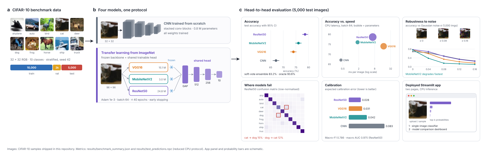

# CIFAR-10 Image Classifier — Multi-Model Deep Learning Web App (v3: XAI + Medical Imaging)

> This folder is a **self-contained** version of the app: everything it needs (code, models, results,
> sample data) is inside `advanced-xai-medical-app/`. Deploy it on Streamlit Cloud with main file path
> `advanced-xai-medical-app/app.py` and Python 3.11. The original app in the repository root is unchanged.

[](https://abusufian-web-application-on-natural-image-data.streamlit.app/)


An interactive Streamlit application that classifies natural images from the **CIFAR-10** dataset
(airplane, automobile, bird, cat, deer, dog, frog, horse, ship, truck), compares four deep-learning
architectures — a custom **CNN**, **ResNet50**, **VGG16** and **MobileNetV2** — side by side, and
extends the same trustworthy-AI toolkit (explainability, uncertainty, calibration, robustness,
out-of-distribution detection) to **medical imaging**: paediatric chest X-ray (PneumoniaMNIST) and
blood-cell microscopy (BloodMNIST).

**Live demo:** https://abusufian-web-application-on-natural-image-data.streamlit.app/

<p align="center">
  
</p>

---

## At a glance



**Figure 1. Benchmark overview.** (a) Stratified CIFAR-10 subsets (10,000 train / 2,000 validation / 5,000 test). (b) A CNN trained from scratch and three frozen ImageNet backbones with a shared head. (c) Results from `results/`: accuracy with 95% CI, accuracy vs. CPU latency, robustness to Gaussian noise, the ResNet50 confusion matrix, calibration (ECE) and the deployed Streamlit app.

## Contents

- [Features](#features)
- [Model comparison results](#model-comparison-results)
- [Repository structure](#repository-structure)
- [Getting started](#getting-started)
- [Reproducing the benchmark](#reproducing-the-benchmark)
- [Known limitations and roadmap](#known-limitations-and-roadmap)
- [Tech stack](#tech-stack)
- [Author](#author)

---

## Features

The app has three pages, selectable from the sidebar.

### 1. Classifier (`app.py`)

- Four **trained** models: the compact CNN (`cifar10_cnn.h5`) and frozen ImageNet ResNet50 / VGG16 /
  MobileNetV2 backbones with classifier heads in `weights/` (96 px input, each backbone's own
  `preprocess_input`). Parameter counts and the audited test accuracy are read from the model and
  `results/deployment_audit.json`.
- Image sources: one sample per class, a **100-image labelled gallery** from the official CIFAR-10
  test set (10 per class), or an **upload** (unlabelled by default; a true label is optional).
- **Prediction** — per-class confidence, sorted-confidence curve, entropy, top-k with cumulative mass,
  top-1/top-2 margin. Results are kept in `st.session_state`, so widgets no longer clear them.
- **Explainability** — Grad-CAM, Grad-CAM++, vanilla saliency, SmoothGrad, Integrated Gradients and
  occlusion for any target class; deletion/insertion faithfulness AUCs and curves; method-agreement
  matrix (Spearman ρ).
- **Uncertainty** — test-time augmentation (24 views) and MC-Dropout (40 passes, transfer heads),
  decomposed into aleatoric (expected entropy) and epistemic (mutual information) parts.
- **Robustness probe** — six corruptions × five severities and an FGSM adversarial attack on the
  current image, with the signed perturbation shown.
- **Session metrics** on labelled images only, and a **batch evaluation** on the 100-image gallery
  (accuracy, top-3, ECE, NLL, per-class recall, confusion matrix, misclassified images).

### 2. Model Comparison dashboard (`pages/1_Model_Comparison.py`)

A research-style comparison of all four models trained and evaluated under **one shared protocol**.
Every metric is computed at page load from the files in `results/`. The page does not import
TensorFlow, so it opens instantly.

| Tab | What it shows |
|---|---|
| 🏁 Comparison | Head-to-head table (accuracy with 95% bootstrap CI, macro precision/recall/F1, top-3 accuracy, macro AUC, ECE, NLL, latency, parameters), grouped bar chart, CI plot, auto-generated key findings, CSV download |
| 📈 Learning curves | Train/validation accuracy and loss per epoch for all models on one timeline, best-epoch markers, generalisation-gap curve, convergence-speed curve |
| 🧩 Per-class | Per-class F1/recall/precision profile, model × class heat-map, row-normalised confusion matrices, most-confused class pairs |
| 🎯 Calibration | Reliability diagram, ECE/NLL/Brier, confidence distribution of correct vs. wrong predictions |
| 📉 ROC | One-vs-rest ROC curves (macro-average or per class) with AUC |
| 🛡️ Robustness | Accuracy vs. Gaussian-noise level, and the share of clean accuracy retained |
| ⚡ Efficiency | Accuracy vs. latency with Pareto frontier, throughput, model size, training time |
| 🧪 Significance & ensemble | Exact McNemar tests with Holm correction, error-overlap (Jaccard) matrix, soft-vote ensemble and oracle accuracy |
| 🔎 Deployment audit | Accuracy of the models exactly as `app.py` serves them, with a list of issues found |

### 3. Medical Imaging Analysis (`pages/2_Medical_Imaging.py`)

Two MedMNIST v2 tasks at 64×64 px (Yang et al., *Scientific Data* 2023), each with a CNN trained by
`benchmark/train_medical.py`. Population-level analyses read pre-computed files in `results/medical/`;
the case-level tabs run the model live on a gallery image or an upload.

| Tab | What it shows |
|---|---|
| 🩺 Overview | Dataset card, class balance and prevalence shift, training curves, labelled test gallery |
| 📋 Clinical performance | Binary: operating-point selection (0.5, Youden, ≥95 % sensitivity, custom), sensitivity, specificity, PPV, NPV, accuracy with Wilson CIs, F1, MCC, Cohen's κ, LR+/LR−, DOR, bootstrap AUROC CI, ROC/PR curves, threshold sweep, PPV/NPV re-computed for any target prevalence. Multi-class: per-class sensitivity/specificity/PPV/NPV/AUROC with CIs, MCC/κ/macro-AUROC with bootstrap CIs, confusion matrix, OvR ROC |
| 📈 Decision curves | Net benefit vs treat-all / treat-none (Vickers & Elkin 2006), standardised net benefit |
| 🎯 Calibration | Reliability diagram, ECE/MCE/Brier/NLL for raw, temperature-scaled and MC-Dropout probabilities |
| 🎲 Uncertainty & referral | Aleatoric vs epistemic (30-pass MC-Dropout) and TTA; error-detection AUROC; risk–coverage/AURC; interactive human–AI referral simulator |
| 🚨 Out-of-distribution | MSP, energy, Mahalanobis and MC-epistemic detectors against CIFAR-10, the other medical modality, noise and intensity-inverted scans (AUROC, FPR@95 %TPR) |
| 🛡️ Robustness & stratification | Six acquisition-style corruptions × five severities, FGSM, and hidden stratification by exposure, contrast, sharpness and noise tertiles |
| 🧬 Representations | t-SNE / PCA of the 128-d embedding with misclassified cases marked; silhouette score |
| 🔬 Explainability | Population-level deletion/insertion faithfulness of six methods vs a random baseline (Wilcoxon tests); live maps, MC-Dropout predictive distribution and method agreement for the selected case; cascading parameter-randomisation sanity check (Adebayo et al. 2018) |
| 🧪 Image analysis / radiomics | Histogram equalisation, gradient magnitude, IBSI-style first-order and GLCM texture features, image-quality indices, and a dataset-shift check (quality percentiles + Mahalanobis/energy OOD flags) for uploads |
| 📑 Model card | Model card in the TRIPOD+AI / CLAIM spirit, plus CSV of per-image predictions and uncertainties |

> Research and teaching tool only — not a medical device and not validated for clinical use.

---

## Model comparison results

Shared protocol: stratified subsets of CIFAR-10 (seed 42): **10,000 train / 2,000 validation /
5,000 test** images. The CNN is trained from scratch at 32×32. The transfer models use frozen
ImageNet backbones at 96×96 with each backbone's own `preprocess_input` and the same classifier
head (GAP → 512 → 256 → 10). All models use Adam (lr 1e-3), batch 64, up to 40 epochs, and early
stopping on validation loss (patience 8, best weights restored). Hardware: 2-core CPU, no GPU.

| Model | Params | Test accuracy (95% CI) | Macro-F1 | Macro AUC | ECE ↓ | Latency (ms/img, CPU) |
|---|---:|---:|---:|---:|---:|---:|
| **ResNet50** | 24.8 M | **78.6%** (77.5–79.8) | **0.786** | **0.975** | **0.028** | 15.8 |
| MobileNetV2 | 3.0 M | 76.0% (74.8–77.2) | 0.761 | 0.969 | 0.042 | 7.6 |
| VGG16 | 15.1 M | 74.0% (72.8–75.2) | 0.739 | 0.964 | 0.031 | 38.2 |
| CNN (from scratch) | 0.8 M | 67.1% (65.8–68.4) | 0.670 | 0.947 | 0.083 | **2.0** |

Key observations:

- **ResNet50** is the most accurate and best-calibrated model. All pairwise accuracy differences are
  statistically significant (McNemar, Holm-corrected p < 0.05).
- **MobileNetV2** gives the best accuracy-for-cost among the pretrained models, but it is the most
  sensitive to input noise.
- The **CNN** is about 8× faster than ResNet50 and the most robust to noise in relative terms, but
  it overfits the most: the train–validation gap reaches about 20%.
- The models make different mistakes. A **soft-vote ensemble** of all four reaches **83.2%**, and at
  least one model is correct on **93.6%** of test images.
- **Cat** is the hardest class for the three pretrained models. For the CNN, dog is hardest by a
  narrow margin. Cat ↔ dog is the most common confusion for every model.

These numbers come from a reduced, CPU-friendly protocol so that all four models train on identical
data. Full-data training, larger input sizes or fine-tuning would raise every score. See
[Reproducing the benchmark](#reproducing-the-benchmark).


**Models as served by `app.py`** (audited on the same 5,000-image test split by
`benchmark/audit_deployed.py`): CNN 68.6 %, ResNet50 84.1 %, VGG16 80.4 %, MobileNetV2 84.8 %. The
served heads were re-trained with the same protocol on the official CIFAR-10 binary release; the table
above was produced from JPEG copies of CIFAR-10, which is why the served transfer models score a few
points higher.

### Medical imaging results

64×64 px MedMNIST v2, official splits, one CNN per task (≈ 0.26 M parameters, CPU-trained). Full
analyses are on the **Medical Imaging** page.

| Task | Test n | Accuracy | AUROC | ECE raw → TS | Clean → mean-corruption acc. | Best OOD detector (worst-case AUROC) | Most faithful XAI |
|---|---:|---:|---:|---:|---:|---|---|
| PneumoniaMNIST (chest X-ray, binary) | 624 | 88.8 % | 0.972 | 0.064 → 0.076 | 84.3 % → 66.3 % | Mahalanobis (0.986) | Grad-CAM |
| BloodMNIST (8 cell types) | 3,421 | 98.0 % | 0.999 (macro) | 0.005 → 0.004 | 98.3 % → 58.8 % | Mahalanobis (1.000) | Grad-CAM++ |

Observations:

- At the Youden-optimal threshold the pneumonia model reaches 96.7 % sensitivity and 88.0 %
  specificity; its PPV falls to about 47 % at a 10 % screening prevalence (transportability panel).
- Temperature scaling fitted on validation data *worsens* pneumonia calibration on test, because
  pneumonia prevalence differs between splits (74 % train vs 62.5 % test) — a label-shift effect.
- Output-based OOD scores (MSP, energy) fail on uniform noise for both tasks, and energy also fails on
  natural images for BloodMNIST (AUROC < 0.5: the model is *more* confident on foreign images);
  feature-space Mahalanobis distance detects every OOD set (AUROC ≥ 0.986).
- Salt-and-pepper noise and contrast loss are the most damaging corruptions for both tasks; JPEG
  compression is nearly harmless; FGSM with ε = 1/255 cuts
  pneumonia accuracy from 84 % to 61 %, and ε = 2/255 to 43 %.
- Grad-CAM-family maps are significantly more faithful than a random map on deletion/insertion
  (Wilcoxon p < 10⁻⁹); vanilla saliency and Integrated Gradients are not, on chest X-ray.

---

## Repository structure

```
.
├── app.py                         # Main Streamlit page: classifier + XAI + uncertainty + robustness
├── cifar_models.py                # Builds the 4 served CIFAR-10 models (shared with the audit)
├── xai_utils.py                   # Grad-CAM(++), saliency, SmoothGrad, IG, occlusion, faithfulness,
│                                  #   MC-Dropout/TTA, calibration, OOD scores, corruptions, radiomics
├── pages/
│   ├── 1_Model_Comparison.py      # Model Comparison dashboard
│   └── 2_Medical_Imaging.py       # Medical Imaging Analysis (PneumoniaMNIST, BloodMNIST)
├── benchmark/
│   ├── train_and_benchmark.py     # Trains and evaluates all 4 CIFAR-10 models under one protocol
│   ├── audit_deployed.py          # Evaluates the models exactly as app.py serves them
│   ├── train_medical.py           # Trains the medical CNNs and pre-computes every medical analysis
│   └── README.md                  # Benchmark usage notes
├── results/
│   ├── benchmark_summary.json     # Learning curves, latency, robustness, metadata
│   ├── test_predictions.npz       # y_true + softmax probabilities per model
│   ├── deployment_audit.json      # Audit of the served models
│   └── medical/<dataset>/         # model.h5, analysis.npz, summary.json per medical task
├── weights/                       # Trained ResNet50 / VGG16 / MobileNetV2 heads (.keras)
├── sample_data/cifar10_test_gallery.npz  # 100 labelled CIFAR-10 test images
├── cifar10_cnn.h5                 # Pre-trained CNN weights used by app.py
├── cifar_image_<class>_1.png      # One sample image per class
├── requirements.txt               # Python dependencies (pinned)
├── packages.txt                   # System packages for Streamlit Cloud
└── .streamlit/config.toml         # Streamlit theme and server settings
```

---

## Getting started

**Requirements:** Python 3.9–3.11 (TensorFlow 2.15 does not support 3.12+).

```bash
git clone https://github.com/datascintist-abusufian/Web-application-by-CNN-model-on-natural-Image-data.git
cd Web-application-by-CNN-model-on-natural-Image-data/advanced-xai-medical-app

python -m venv .venv
source .venv/bin/activate          # Windows: .venv\Scripts\activate
pip install -r requirements.txt

streamlit run app.py
```

Then open http://localhost:8501. The **Model Comparison** and **Medical Imaging** pages appear in the sidebar.

Usage:

1. In the sidebar, select a model and click **Load model**.
2. Pick a class sample, a gallery image, or upload an image.
3. Click **Analyze image**, then use the tabs: prediction, explainability, uncertainty, robustness
   probe, session metrics and batch evaluation.
4. Open **Model Comparison** for the four-model benchmark, or **Medical Imaging** for the chest X-ray
   and blood-cell analyses.

---

## Reproducing the benchmark

```bash
# Train and evaluate all four models (CPU ≈ 30 min; GPU a few minutes)
python benchmark/train_and_benchmark.py --save-weights

# Evaluate the models exactly as app.py serves them
python benchmark/audit_deployed.py
```

The dashboard picks up the new files in `results/` automatically. On a GPU (e.g. Google Colab) you
can scale up to near-full data and the native 224 px input:

```bash
python benchmark/train_and_benchmark.py --img-size 224 \
  --train-per-class 4500 --val-per-class 500 --test-per-class 1000
```

Useful flags: `--epochs`, `--batch`, `--seed`, `--models CNN,ResNet50`, `--npz <local cifar10.npz>`.
Trained weights go to `results/weights/`, which is git-ignored; the served heads are copies in `weights/`.

Medical page (CPU ≈ 30 min for both datasets):

```bash
mkdir -p data && cd data
curl -LO https://zenodo.org/records/10519652/files/pneumoniamnist_64.npz
curl -LO https://zenodo.org/records/10519652/files/bloodmnist_64.npz
cd ..
python benchmark/train_medical.py --data-dir data            # writes results/medical/
python benchmark/train_medical.py --data-dir data --ood-only  # re-score OOD for saved models
```

---

## Known limitations and roadmap

Fixed in v3 (verified by `benchmark/audit_deployed.py`, shown in the dashboard's **Deployment audit** tab):

- [x] ResNet50, VGG16 and MobileNetV2 now serve **trained** heads (previously random, ≈10–16 % accuracy).
- [x] Backbone-specific `preprocess_input` at 96 px, identical to the training protocol.
- [x] Model information (parameters, architecture) is read from the loaded model.
- [x] Uploads are unlabelled by default and no longer contaminate session accuracy.
- [x] Results persist across widget changes; all ten classes are shown on the landing page.
- [x] Grad-CAM and five further attribution methods with faithfulness metrics.

Still open:

- [ ] Fine-tuning and data augmentation for the CIFAR-10 transfer models; a Vision Transformer baseline.
- [ ] External validation of the medical models on a second hospital's data; demographic subgroup
      analysis (MedMNIST has no patient metadata).
- [ ] Higher-resolution medical inputs (128/224 px MedMNIST+) for finer Grad-CAM localisation.

## Tech stack

- **Deep learning:** TensorFlow / Keras (CNN, ResNet50, VGG16, MobileNetV2 transfer learning)
- **App framework:** Streamlit (multi-page)
- **Visualisation:** Plotly
- **Analysis:** NumPy, pandas, scikit-learn, SciPy
- **Datasets:** [CIFAR-10](https://www.cs.toronto.edu/~kriz/cifar.html): 60,000 32×32 colour
  images in 10 classes (Krizhevsky, 2009); [MedMNIST v2](https://medmnist.com/) PneumoniaMNIST and
  BloodMNIST (Yang et al., 2023; CC BY 4.0)

---

## Author

**Md Abu Sufian** — PhD researcher in Computer Science, University of East London.
Research interests: explainable and multimodal AI for medical and cardiovascular imaging.

- Website: [abusufian.dev](https://abusufian.dev)
- GitHub: [@datascintist-abusufian](https://github.com/datascintist-abusufian)

This project is for research and educational purposes. Issues and pull requests are welcome.
